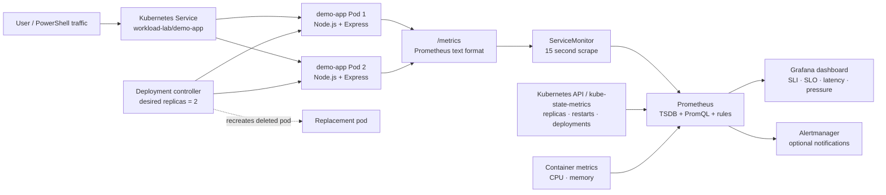
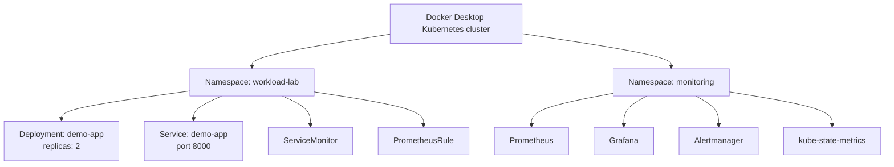

# Excalidraw-ready architecture

Paste this Mermaid code into an Excalidraw Mermaid diagram importer, or use it as the drawing blueprint for the presentation.



## Namespace structure



## Failure interpretation

```text
HTTP /fail while pods exist
    -> Node.js returns HTTP 503
    -> demo_http_requests_total{status="503"} increases
    -> 5xx rate and availability SLI change

replicas scaled to zero
    -> Service has no endpoints
    -> client sees connection failure / no response, not an app-generated HTTP 5xx
    -> up, replica availability, and target-down signals change
```
